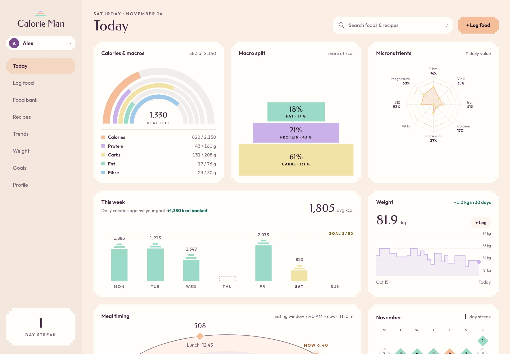
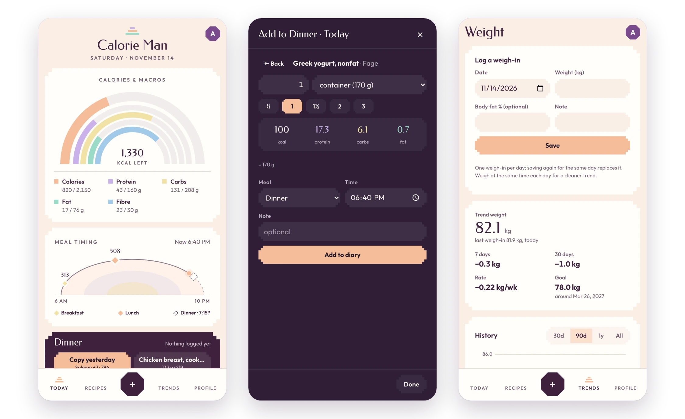
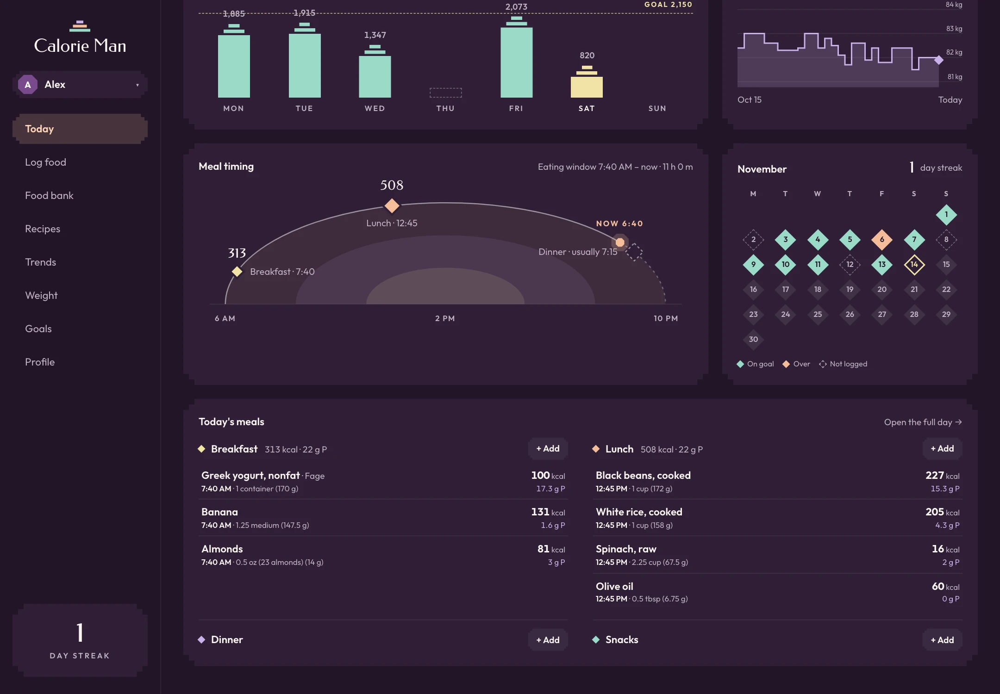
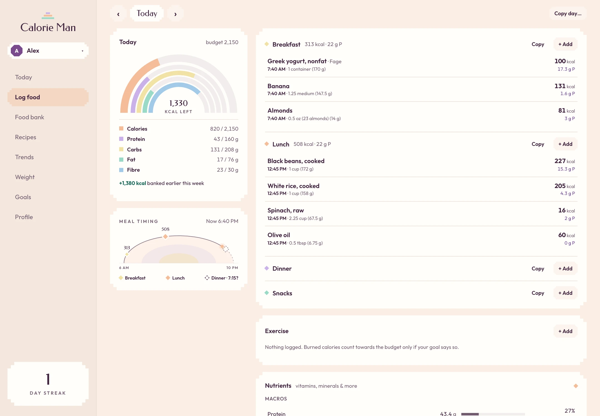
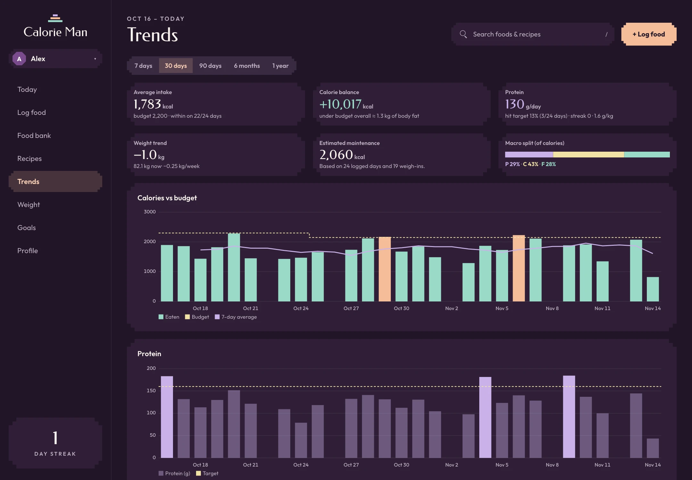
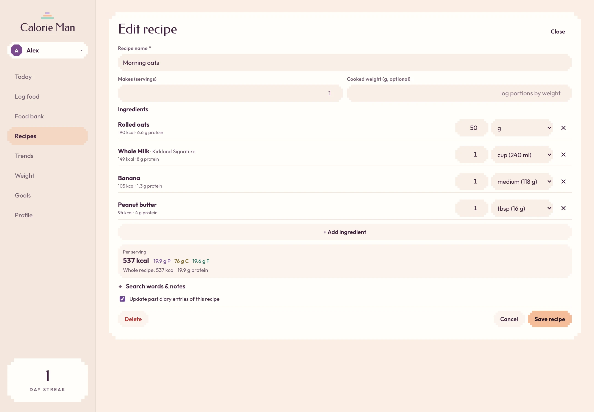

# Calorie Man

A calorie, protein and nutrient tracker for a household, built to run on your home network. One small Rust
binary serves the web UI, a JSON API and an MCP endpoint for AI assistants. Data is a single SQLite file.

**[Try the live demo →](https://about.hacktohell.org/calorie-man/)** It runs entirely in your browser: the
same Rust backend compiled to WebAssembly, with sample data for two people. Nothing you enter is saved;
reloading the page starts over.



<p align="center"></p>

| | |
|---|---|
|  |  |
|  |  |

The UI follows the "Terrace" design (`docs/design/calorie-man-terrace-2a.html`): stepped corners, pastel macro
colours, Federo + Outfit (bundled, works offline), light and dark themes (System/Light/Dark in Profile).
Desktop has a sidebar (Today, Log food, Food bank, Recipes, Trends, Weight, Goals, Profile); phones get a
bottom bar with an octagon + button.

- **Shared food library.** Foods and recipes (e.g. "Morning oats": oats + milk + banana + peanut butter)
  are shared by everyone. Diaries, goals and weights are per person. Switch person from the top-right menu;
  there are no passwords.
- **All the nutrients.** Calories, macros, fat breakdown, sugars, 11 minerals, 14 vitamins, choline,
  caffeine and alcohol. Unknown values stay unknown (not zero), and coverage is shown.
- **Calorie budget.** Effective-dated goals, optional exercise credit, a weekly "bank" (weeks start on
  Monday), and a goal calculator (Mifflin-St Jeor plus maintenance estimated from your own logs and weight
  trend).
- **Meal timing.** Each entry can record when it was eaten; it defaults to now for the current meal and
  can be edited. Today shows the day's sittings on a sun-path arc with the eating window and when you
  usually eat the next meal.
- **Protein.** A daily target (or g/kg), hit rate, streak and share of calories.
- **Trends.** Calories vs budget, protein, weight with a smoothed trend, macro split, running balance, and
  vitamin and mineral averages over 7 days to a year.
- **Weight log.** kg or lb, an EMA trend, rate per week, goal ETA.
- **Product lookup.** USDA FoodData Central (Costco's Kirkland products have UPCs there; whole foods have
  full vitamin profiles) and Open Food Facts. "costco" also searches "kirkland". Barcode lookup by digits.
- **AI via MCP.** Assistants can search, import or create foods, build recipes, log meals, weights and
  exercise, set goals and read summaries.

## Self-hosting

**Docker** (any machine on your network):

```sh
docker build -t calorie-man .
docker run -d --name calorie-man --restart unless-stopped -p 8484:8484 -v calorie-man-data:/data calorie-man
```

Open `http://<that-machine>:8484` on any device at home and add the people in your household. The same thing
as a Compose file: `docker compose -f deploy/docker-compose.yml up -d`.

**HTTPS with real certificates:** [deploy/caddy/](deploy/caddy/README.md) runs Calorie Man behind Caddy,
which gets Let's Encrypt certificates through a DNS challenge, so a name like `calories.example.com` works at
home with nothing exposed to the internet. Caddy's own CA (no domain) and a public, password-protected setup
are options too.

**Without Docker:**

```sh
make release                          # needs Rust + Node; builds target/release/calorie-man with the UI inside
./target/release/calorie-man serve    # http://<this-machine>:8484 on your network, data in ./data/calorie-man.db
```

Options: `--db PATH` (`CALORIE_MAN_DB`), `--bind ADDR` (`CALORIE_MAN_BIND`, default `0.0.0.0:8484`).
Try it with demo data first: `./target/release/calorie-man seed-demo --db data/demo.db` and serve that file.
There is also a systemd unit (`deploy/calorie-man.service`) and a macOS launchd agent
(`deploy/com.calorie-man.plist`). Add the page to your phone's home screen for an app-like experience.

| Variable | Purpose |
|---|---|
| `USDA_API_KEY` | Free key from https://fdc.nal.usda.gov/api-key-signup (or paste it in Settings). Without one, the shared `DEMO_KEY` allows about 30 searches an hour. |
| `CALORIE_MAN_OFFLINE=1` | Disable online lookups. |
| `CALORIE_MAN_ALLOWED_ORIGINS` | Extra browser origins allowed to call `/mcp` (comma-separated, `*` for any). |
| `TZ` | Time zone used until each person sets their own in Profile. |
| `RUST_LOG` | Logging, e.g. `calorie_man=debug`. |

**Security:** there is no authentication by design. Keep the server on a trusted network; do not
port-forward it to the internet (the Caddy setup's `public` mode adds a password if you must). Barcodes are
looked up by typing the digits; there is no camera scanner.

## Connecting an AI assistant (MCP)

The endpoint is `http://<host>:8484/mcp` (Streamable HTTP, stateless). Add `?user=<name>` to make tools act
for that person by default; otherwise the assistant passes `user` itself. Settings → AI assistants shows the
exact URL.

```sh
# Claude Code
claude mcp add --transport http calorie-man "http://192.168.1.20:8484/mcp?user=Alex"
```

```json
// Claude Desktop (stdio-only clients): the binary bridges stdio to the server
{ "mcpServers": { "calorie-man": { "command": "/usr/local/bin/calorie-man",
    "args": ["mcp-stdio", "--url", "http://192.168.1.20:8484/mcp?user=Alex"] } } }
```

Tools: `list_users`, `get_nutrient_catalog`, `search_foods`, `get_food`, `search_online_foods`,
`lookup_barcode`, `import_online_food`, `create_food`, `update_food`, `delete_food`, `create_recipe`,
`log_food`, `quick_add`, `get_diary`, `update_entry`, `delete_entry`, `copy_meal`, `log_exercise`,
`log_weight`, `get_weights`, `get_goals`, `set_goals`, `get_summary`. See [docs/MCP.md](docs/MCP.md).

Example: *"Log a cup of Costco milk for breakfast."* The assistant searches the library (no match),
searches online (USDA has "Kirkland Signature Whole Milk", 62 kcal/100 ml, cup = 240 ml), imports it with
the alias "costco milk" so next time it is a library hit, then logs 1 cup (149 kcal).

## Development

```
src/            Rust server (axum + rusqlite)
  nutrients.rs  the nutrient catalog every layer derives from
  service/      business logic shared by the REST API and MCP
  api.rs mcp.rs external.rs (USDA/OFF) seed.rs
demo/           the same backend as WebAssembly, for the browser demo
web/            Svelte 5 + Vite UI, Playwright tests
tests/          Rust API/MCP integration tests and saved real USDA/OFF responses
deploy/         Docker Compose (plain and with Caddy), systemd, launchd
docs/           PLAN.md (design), MCP.md, BUGBASH.md, screenshots
```

```sh
make dev        # server on :8484 + Vite with hot reload on :5173
make test       # fmt, clippy, svelte-check, Rust unit + integration tests, Playwright E2E
make bugbash    # full bug bash: sweep, fuzz, MCP inspector, report, demo server (docs/BUGBASH.md)
```

In pi, `/bugbash` runs a bug bash session (`.pi/prompts/bugbash.md`).

**The browser demo** is built locally and published to the `gh-pages` branch. In the demo build
(`vite build --mode demo`), the page answers its own `/api` and `/mcp` requests with the Rust router compiled
to `wasm32-unknown-unknown`, on an in-memory SQLite seeded with 60 days of sample data. USDA lookups go
straight from the browser; Open Food Facts text search is off there because its search server does not
allow browser requests (barcodes still work).

```sh
make demo           # needs: rustup target add wasm32-unknown-unknown, wasm-bindgen-cli (version in Cargo.lock),
                    #        a clang that targets wasm32 (macOS: brew install llvm), optionally binaryen
make demo-serve     # http://127.0.0.1:8686/calorie-man/
make demo-test      # Playwright against the demo build
make demo-publish   # test, then push web/dist-demo to gh-pages
node web/scripts/readme-shots.mjs   # refresh docs/screenshots from the demo build
```

Data model, API and design decisions: [docs/PLAN.md](docs/PLAN.md). Backups: Settings → Data (a SQLite
snapshot, a full JSON export and per-person CSV), or copy `calorie-man.db` while the server is stopped.
